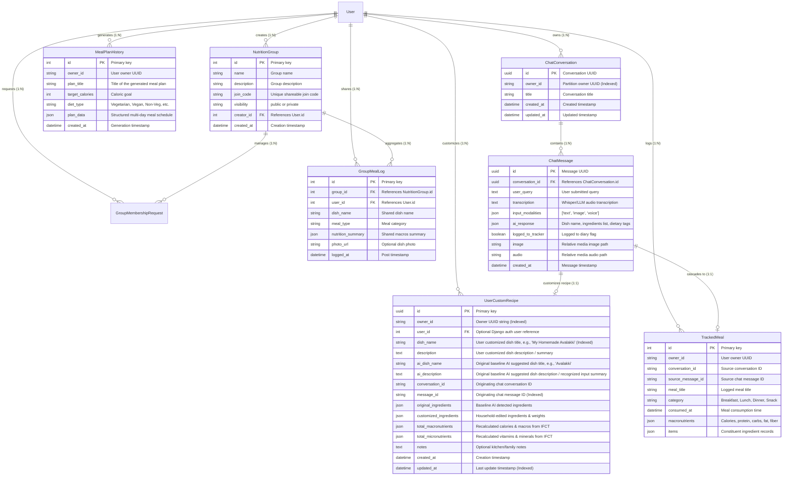

# NutriGuide-AI Entity-Relationship (ER) Diagrams

This file serves as the **central repository for all database design and Entity-Relationship (ER) diagrams** in NutriGuide-AI. It contains the complete schema for the Indian Food Composition Tables (IFCT 2017) reference database, its satellite tables, indexes, and dedicated placeholders for future application schemas (e.g., user profiles, meal tracking logs, recipes, dietary preferences).

---

## 1. IFCT 2017 Food Composition & Satellite Schema

The diagram below details the **modular satellite architecture**. Instead of storing ~200 nutritional variables in a single flat table, domain-specific nutrients are partitioned into satellite tables linked via `OneToOneField(Food)` with reverse relationships, alongside a multi-lingual relational table for regional search:

```mermaid
erDiagram
    FoodGroup ||--o{ Food : "categorizes (1:N)"
    Food ||--o{ FoodVernacularName : "indexes regional names (1:N)"
    Food ||--o| ProximateNutrient : "Table 1 (1:1)"
    Food ||--o| VitaminNutrient : "Tables 2 & 3 (1:1)"
    Food ||--o| CarotenoidNutrient : "Table 4 (1:1)"
    Food ||--o| MineralNutrient : "Table 5 (1:1)"
    Food ||--o| SugarNutrient : "Table 6 (1:1)"
    Food ||--o| FattyAcidNutrient : "Tables 7 & 12 (1:1)"
    Food ||--o| AminoAcidNutrient : "Table 8 (1:1)"
    Food ||--o| OrganicAcidNutrient : "Table 9 (1:1)"
    Food ||--o| PolyphenolNutrient : "Table 10 (1:1)"
    Food ||--o| BioactiveNutrient : "Table 11 (1:1)"

    FoodGroup {
        string code PK "Group letter code (A to T, e.g., 'A', 'T')"
        string name "Group name, e.g., 'Cereals and Millets'"
        text description "Optional description"
    }

    Food {
        string food_code PK "IFCT code (e.g., 'A001', 'T001')"
        string group_id FK "References FoodGroup.code"
        string name "Common name (Indexed)"
        string scientific_name "Botanical/taxonomic name (Indexed)"
        int no_of_regions "Number of sampling regions across India"
        json vernacular_names "O(1) dictionary: {'Hindi': '...', 'Tamil': '...'}"
        datetime created_at "Record creation timestamp"
    }

    FoodVernacularName {
        int id PK "Primary key"
        string food_id FK "References Food.food_code"
        string language "Language (Indexed: Hindi, Tamil, Telugu, etc.)"
        string name "Regional food name (Indexed)"
    }

    ProximateNutrient {
        int id PK "Primary key"
        string food_id FK "References Food.food_code (OneToOne)"
        float moisture_g "Moisture (WATER)"
        float protein_g "Protein (PROTCNT)"
        float ash_g "Ash (ASH)"
        float total_fat_g "Total Fat (FATCE)"
        float total_fiber_g "Dietary Fibre (FIBTG)"
        float insoluble_fiber_g "Insoluble Fibre (FIBINS)"
        float soluble_fiber_g "Soluble Fibre (FIBSOL)"
        float carbohydrates_g "Available Carbohydrates (CHOAVLDF)"
        float energy_kj "Energy in kJ"
        float energy_kcal "Energy in kcal"
        json sd_values "Standard deviation dictionary"
    }

    VitaminNutrient {
        int id PK "Primary key"
        string food_id FK "References Food.food_code (OneToOne)"
        float thiamine_b1_mg "Thiamine B1"
        float riboflavin_b2_mg "Riboflavin B2"
        float niacin_b3_mg "Niacin B3"
        float pantothenic_acid_b5_mg "Pantothenic Acid B5"
        float vitamin_b6_mg "Total B6"
        float biotin_b7_mcg "Biotin B7"
        float folates_b9_mcg "Total Folates B9"
        float vitamin_c_mg "Vitamin C (Ascorbic Acid)"
        float ergocalciferol_d2_mcg "Vitamin D2 Ergocalciferol"
        float alpha_tocopherol_mcg "Alpha-tocopherol"
        float beta_tocopherol_mcg "Beta-tocopherol"
        float gamma_tocopherol_mcg "Gamma-tocopherol"
        float delta_tocopherol_mcg "Delta-tocopherol"
        float alpha_tocotrienol_mcg "Alpha-tocotrienol"
        float beta_tocotrienol_mcg "Beta-tocotrienol"
        float gamma_tocotrienol_mcg "Gamma-tocotrienol"
        float delta_tocotrienol_mcg "Delta-tocotrienol"
        float vitamin_e_mg "Vitamin E alpha-tocopherol equivalent"
        float vitamin_k1_mcg "Vitamin K1 Phylloquinones"
        json sd_values "Standard deviation dictionary"
    }

    CarotenoidNutrient {
        int id PK "Primary key"
        string food_id FK "References Food.food_code (OneToOne)"
        float lutein_mcg "Lutein (LUTN)"
        float zeaxanthin_mcg "Zeaxanthin (ZEA)"
        float lycopene_mcg "Lycopene (LYCPN)"
        float beta_cryptoxanthin_mcg "Beta-Cryptoxanthin (CRYPXB)"
        float gamma_carotene_mcg "Gamma-Carotene (CARTG)"
        float alpha_carotene_mcg "Alpha-Carotene (CARTA)"
        float beta_carotene_mcg "Beta-Carotene (CARTB)"
        float total_carotenoids_mcg "Total Carotenoids (CARTOT)"
        json sd_values "Standard deviation dictionary"
    }

    MineralNutrient {
        int id PK "Primary key"
        string food_id FK "References Food.food_code (OneToOne)"
        float calcium_mg "Calcium (CA)"
        float phosphorus_mg "Phosphorus (P)"
        float magnesium_mg "Magnesium (MG)"
        float sodium_mg "Sodium (NA)"
        float potassium_mg "Potassium (K)"
        float iron_mg "Iron (FE)"
        float zinc_mg "Zinc (ZN)"
        float copper_mg "Copper (CU)"
        float manganese_mg "Manganese (MN)"
        float selenium_mcg "Selenium (SE)"
        float chromium_mg "Chromium (CR)"
        float cobalt_mg "Cobalt (CO)"
        float nickel_mg "Nickel (NI)"
        float molybdenum_mg "Molybdenum (MO)"
        float aluminium_mg "Aluminium (AL)"
        float arsenic_mcg "Arsenic (AS)"
        float cadmium_mg "Cadmium (CD)"
        float lead_mg "Lead (PB)"
        float lithium_mg "Lithium (LI)"
        float mercury_mcg "Mercury (HG)"
        json sd_values "Standard deviation dictionary"
    }

    SugarNutrient {
        int id PK "Primary key"
        string food_id FK "References Food.food_code (OneToOne)"
        float total_starch_g "Total Starch (STARCH)"
        float fructose_g "Fructose (FRUS)"
        float glucose_g "Glucose (GLUS)"
        float sucrose_g "Sucrose (SUCS)"
        float maltose_g "Maltose (MALS)"
        float total_free_sugars_g "Total Free Sugars (SUGARS)"
        json sd_values "Standard deviation dictionary"
    }

    FattyAcidNutrient {
        int id PK "Primary key"
        string food_id FK "References Food.food_code (OneToOne)"
        boolean is_cooking_oil_percent "True if % of fatty acids (Table 12), False for mg/100g"
        float butyric_c4_0_mg "Butyric C4:0"
        float caproic_c6_0_mg "Caproic C6:0"
        float caprylic_c8_0_mg "Caprylic C8:0"
        float capric_c10_0_mg "Capric C10:0"
        float lauric_c12_0_mg "Lauric C12:0"
        float myristic_c14_0_mg "Myristic C14:0"
        float palmitic_c16_0_mg "Palmitic C16:0"
        float stearic_c18_0_mg "Stearic C18:0"
        float arachidic_c20_0_mg "Arachidic C20:0"
        float behenic_c22_0_mg "Behenic C22:0"
        float lignoceric_c24_0_mg "Lignoceric C24:0"
        float total_sfa_mg "Total SFA (TSFA)"
        float myristoleic_c14_1_mg "Myristoleic C14:1"
        float palmitoleic_c16_1_mg "Palmitoleic C16:1"
        float elaidic_c18_1n9t_mg "Elaidic C18:1n9t trans"
        float oleic_c18_1n9_mg "Oleic C18:1n9"
        float eicosenoic_c20_1n9_mg "Eicosenoic C20:1n9"
        float erucic_c22_1n9_mg "Erucic C22:1n9"
        float nervonic_c24_1n9_mg "Nervonic C24:1n9"
        float total_mufa_mg "Total MUFA (TMUFA)"
        float linoleic_c18_2n6_mg "Linoleic C18:2n6 (LA)"
        float eicosadienoic_c20_2_mg "Eicosadienoic C20:2"
        float alpha_linolenic_c18_3n3_mg "Alpha-Linolenic C18:3n3 (ALA)"
        float eicosatrienoic_c20_3n6_mg "Eicosatrienoic C20:3n6"
        float arachidonic_c20_4n6_mg "Arachidonic C20:4n6 (AA)"
        float epa_c20_5n3_mg "Eicosapentaenoic C20:5n3 (EPA)"
        float dha_c22_6n3_mg "Docosahexaenoic C22:6n3 (DHA)"
        float total_pufa_mg "Total PUFA (TPUFA)"
        float cholesterol_mg "Cholesterol (CHOLC)"
        json sd_values "Standard deviation dictionary"
    }

    AminoAcidNutrient {
        int id PK "Primary key"
        string food_id FK "References Food.food_code (OneToOne)"
        float histidine_g "Histidine (HIS) g/100g protein"
        float isoleucine_g "Isoleucine (ILE) g/100g protein"
        float leucine_g "Leucine (LEU) g/100g protein"
        float lysine_g "Lysine (LYS) g/100g protein"
        float methionine_g "Methionine (MET) g/100g protein"
        float cystine_g "Cystine (CYS) g/100g protein"
        float phenylalanine_g "Phenylalanine (PHE) g/100g protein"
        float threonine_g "Threonine (THR) g/100g protein"
        float tryptophan_g "Tryptophan (TRP) g/100g protein"
        float valine_g "Valine (VAL) g/100g protein"
        float alanine_g "Alanine (ALA) g/100g protein"
        float arginine_g "Arginine (ARG) g/100g protein"
        float aspartic_acid_g "Aspartic Acid (ASP) g/100g protein"
        float glutamic_acid_g "Glutamic Acid (GLU) g/100g protein"
        float glycine_g "Glycine (GLY) g/100g protein"
        float proline_g "Proline (PRO) g/100g protein"
        float serine_g "Serine (SER) g/100g protein"
        float tyrosine_g "Tyrosine (TYR) g/100g protein"
        json sd_values "Standard deviation dictionary"
    }

    OrganicAcidNutrient {
        int id PK "Primary key"
        string food_id FK "References Food.food_code (OneToOne)"
        float oxalate_total_mg "Total Oxalate in mg"
        float oxalate_soluble_mg "Soluble Oxalate in mg"
        float oxalate_insoluble_mg "Insoluble Oxalate in mg"
        float cis_aconitic_acid_mg "Cis-Aconitic Acid in mg"
        float citric_acid_mg "Citric Acid (CITAC)"
        float fumaric_acid_mg "Fumaric Acid (FUMAC)"
        float malic_acid_mg "Malic Acid (MALAC)"
        float quinic_acid_mg "Quinic Acid"
        float succinic_acid_mg "Succinic Acid (SUCAC)"
        float tartaric_acid_mg "Tartaric Acid (TARAC)"
        json sd_values "Standard deviation dictionary"
    }

    PolyphenolNutrient {
        int id PK "Primary key"
        string food_id FK "References Food.food_code (OneToOne)"
        float dihydroxy_benzoic_3_4_mg "3,4-Dihydroxybenzoic acid"
        float hydroxy_benzaldehyde_3_mg "3-Hydroxybenzaldehyde"
        float protocatechuic_acid_mg "Protocatechuic acid"
        float vanillic_acid_mg "Vanillic acid"
        float gallic_acid_mg "Gallic acid (GALLAC)"
        float cinnamic_acid_mg "Cinnamic acid"
        float o_coumaric_acid_mg "o-Coumaric acid"
        float p_coumaric_acid_mg "p-Coumaric acid"
        float caffeic_acid_mg "Caffeic acid"
        float chlorogenic_acid_mg "Chlorogenic acid (CHLRAC)"
        float ferulic_acid_mg "Ferulic acid (FERAC)"
        float syringic_acid_mg "Syringic acid"
        float sinapinic_acid_mg "Sinapinic acid"
        float ellagic_acid_mg "Ellagic acid"
        float apigenin_mg "Apigenin (APIGEN)"
        float apigenin_6_c_glucoside_mg "Apigenin-6-C-glucoside"
        float apigenin_7_o_neohesperidoside_mg "Apigenin-7-O-neohesperidoside"
        float luteolin_mg "Luteolin (LUTEOL)"
        float kaempferol_mg "Kaempferol (KAEMF)"
        float quercetin_mg "Quercetin (QUERCE)"
        float quercetin_3_beta_d_glucoside_mg "Quercetin-3-beta-D-glucoside"
        float quercetin_3_o_rutinoside_mg "Quercetin-3-O-rutinoside"
        float quercetin_3_galactoside_mg "Quercetin-3-galactoside"
        float isorhamnetin_mg "Isorhamnetin"
        float myricetin_mg "Myricetin"
        float resveratrol_mg "Resveratrol"
        float hesperetin_mg "Hesperetin (HESPT)"
        float naringenin_mg "Naringenin"
        float hesperidin_mg "Hesperidin (HESPD)"
        float daidzein_mg "Daidzein (DAIDZN)"
        float genistein_mg "Genistein (GNSTEIN)"
        float epicatechin_mg "(-)-Epicatechin (EPICATEC)"
        float epigallocatechin_mg "(-)-Epigallocatechin"
        float epigallocatechin_3_gallate_mg "(-)-Epigallocatechin-3-gallate (EGCG)"
        float catechin_mg "(+)-Catechin"
        float gallocatechin_mg "Gallocatechin"
        float epicatechin_gallate_mg "(-)-Epicatechin gallate"
        float total_polyphenols_mg "Total Polyphenols (POLYT)"
        json sd_values "Standard deviation dictionary"
    }

    BioactiveNutrient {
        int id PK "Primary key"
        string food_id FK "References Food.food_code (OneToOne)"
        float raffinose_g "Raffinose (RAFS)"
        float stachyose_g "Stachyose (STAS)"
        float verbascose_g "Verbascose (VERS)"
        float ajugose_g "Ajugose"
        float campesterol_mg "Campesterol (CAMT)"
        float stigmasterol_mg "Stigmasterol (STGSTR)"
        float beta_sitosterol_mg "Beta-Sitosterol (SITSTR)"
        float phytate_mg "Total Phytate (PHYTC)"
        float total_saponin_mg "Total Saponin"
        json sd_values "Standard deviation dictionary"
    }
```



---

## 2. Relational Indexes & Performance Optimization

To ensure fast query execution across large-scale relational queries and text searches, the following indexes are defined:

| Model | Indexed Fields | Index Type | Purpose |
| :--- | :--- | :---: | :--- |
| `Food` | `food_code` | Primary Key (B-Tree) | Instant $O(1)$ lookups by food code. |
| `Food` | `name` | B-Tree (`db_index=True`) | Substring/prefix search on common English food names. |
| `Food` | `scientific_name`| B-Tree (`db_index=True`) | Botanical/taxonomic lookups. |
| `Food` | `group_id` | Foreign Key (B-Tree) | Filtering foods by category code (`A` through `T`). |
| `FoodVernacularName` | `name` | B-Tree (`db_index=True`) | Rapid multi-lingual text search across regional languages. |
| `FoodVernacularName` | `(language, name)`| Composite B-Tree Index | Scoped search within a specific language (e.g. Hindi, Tamil). |
| All 10 Satellites | `food_id` | Unique (OneToOne) | Zero-overhead joins via Django `select_related(...)`. |

---

## 3. Situational Query Patterns

Because the tables are normalized around `Food`, queries are fast and selective:

```python
# 1. Macro lookup only (avoids joining remaining 9 tables)
Food.objects.select_related("proximates").filter(name__icontains="rice")

# 2. Cardiovascular health check (selective join on fatty acids)
Food.objects.select_related("proximates", "fatty_acids").get(food_code="M001")

# 3. Protein quality assessment (selective join on amino acids)
Food.objects.select_related("proximates", "amino_acids").get(food_code="A003")

# 4. Kidney stone / oxalate risk (selective join on organic acids & minerals)
Food.objects.select_related("minerals", "organic_acids").get(food_code="C001")
```

---

## 4. Application Database Schema (`core_app.sqlite3`)

NutriGuide-AI partitions application state into a primary writable database (`core_app.sqlite3` routed via `CoreAppDatabaseRouter`), completely separated from the read-only IFCT reference database (`db.sqlite3`).

### Entity-Relationship Diagram: Application & Household Personalization



---

## 5. Dual-Database Partitioning Architecture

NutriGuide-AI enforces a strict architectural boundary between reference data and application state:

| Database Alias | Physical File | Access Mode | Contents & Responsibilities |
| :--- | :--- | :---: | :--- |
| **`nutrition`** | `db.sqlite3` | **Read-Only** | ICMR-NIN IFCT 2017 scientific reference tables (`Food`, `FoodGroup`, `FoodVernacularName`, and all 10 nutrient satellite tables). |
| **`default`** | `core_app.sqlite3` | **Read-Write** | Application users, authentication, `UserCustomRecipe`, `ChatMessage`, `TrackedMeal`, `MealPlanHistory`, and `NutritionGroup`. |

### Database Routing (`CoreAppDatabaseRouter`)
- Routes all reads and writes for `app_label == 'nutrition'` to the `nutrition` alias.
- Routes all other models (`chat_history`, `auth`, `admin`, `sessions`) to the `default` alias.
- Prevents cross-database foreign key constraints at the database engine level while maintaining loose foreign UUID linkages in application services.

---

## 6. Frontend Architectural Guidelines (Pure Python / PyScript Policy)

> [!IMPORTANT]
> **Strict Rule for Engineering & AI Agents**:
> NutriGuide-AI's frontend contains **zero JavaScript application files**.
> - Client-side state coordination, modal dialogs, and DOM mutations MUST be written strictly in Python under `web_frontend/src/` via PyScript.
> - Network requests and DOM swaps are driven declaratively by HTMX.
> - Never inject JavaScript code, `<script>` tags, or inline JS attributes (`onclick`, `onsubmit`, etc.) into HTML templates.
