```mermaid
flowchart TD
    %% Styling Classes
    classDef client fill:#e1f5fe,stroke:#0288d1,stroke-width:2px;
    classDef api fill:#ede7f6,stroke:#512da8,stroke-width:2px;
    classDef graphNode fill:#e8f5e9,stroke:#2e7d32,stroke-width:2px;
    classDef service fill:#fff3e0,stroke:#e65100,stroke-width:2px;
    classDef condition fill:#fff9c4,stroke:#fbc02d,stroke-width:2px;
    classDef storage fill:#fce4ec,stroke:#c2185b,stroke-width:2px;
    classDef pipeline fill:#e0f2f1,stroke:#00796b,stroke-width:2px;

    %% ==========================================
    %% PIPELINE 1: OFFLINE IFCT DATA INGESTION
    %% ==========================================
    subgraph Ingestion_Pipeline ["A. Reference Database Ingestion (IFCT 2017)"]
        PDF["IFCT 2017 Reference PDF<br/>(raw_data/IFCT2017_16122024.pdf)"]:::storage
        
        Parser["Coordinate-Aware IFCT Parser<br/>(nutrition/ingestion/ifct_parser.py)<br/>• PyMuPDF horizontal binning (x_start, x_end)<br/>• Dynamic header recognition (P1/P2/P3/P4)<br/>• Parses Tables 1-12 & Vernacular Names"]:::pipeline
        
        IngestRunner["Ingestion Command / Runner<br/>(python manage.py ingest_ifct)<br/>• Atomic database transaction<br/>• update_or_create idempotent loading"]:::pipeline
        
        PDF --> Parser
        Parser --> IngestRunner
    end

    %% ==========================================
    %% PIPELINE 2: RELATIONAL DATABASE & SATELLITES
    %% ==========================================
    subgraph Database_Layer ["B. Database Layer (PostgreSQL / SQLite)"]
        FoodCore[("Food & FoodGroup<br/>• 20 Groups (A-T)<br/>• 542 Foods (528 + 14 Oils)<br/>• vernacular_names JSON")]:::storage
        
        FoodVernacular[("FoodVernacularName<br/>• 4,386 Multi-lingual Records<br/>• Indexed across 17 Languages")]:::storage
        
        Satellites[("10 Domain-Specific Satellite Tables<br/>(OneToOneField with Food)<br/>• ProximateNutrient (Table 1)<br/>• VitaminNutrient (Tables 2 & 3)<br/>• CarotenoidNutrient (Table 4)<br/>• MineralNutrient (Table 5)<br/>• SugarNutrient (Table 6)<br/>• FattyAcidNutrient (Tables 7 & 12)<br/>• AminoAcidNutrient (Table 8)<br/>• OrganicAcidNutrient (Table 9)<br/>• PolyphenolNutrient (Table 10)<br/>• BioactiveNutrient (Table 11)")]:::storage
        
        IngestRunner -->|writes| FoodCore
        IngestRunner -->|writes| FoodVernacular
        IngestRunner -->|writes| Satellites
        FoodCore --- FoodVernacular
        FoodCore --- Satellites
    end

    %% ==========================================
    %% PIPELINE 3: CLIENT & DJANGO NINJA API
    %% ==========================================
    Client(["User / Client App<br/>(Web, Mobile, Postman, Curl)"]):::client

    subgraph API_Layer ["C. Django Ninja API Layer (nutrition/api.py)"]
        EndpointText["POST /api/nutrition/analyze/text<br/>JSON payload: text, user_id"]:::api
        EndpointMulti["POST /api/nutrition/analyze<br/>Multipart: text, image, voice"]:::api
        EndpointHealth["GET /api/nutrition/health<br/>Checks API & llama-server"]:::api
    end

    Client -->|text meal description| EndpointText
    Client -->|text + photo + audio| EndpointMulti
    Client -->|health probe| EndpointHealth

    %% ==========================================
    %% PIPELINE 4: LANGGRAPH ORCHESTRATION & DECOMPOSITION LOOP
    %% ==========================================
    subgraph LangGraph_Workflow ["D. LangGraph Orchestration & Decomposition Loop (nutrition/graph/workflow.py)"]
        RunWorkflow["run_nutrition_workflow()<br/>• Initializes full NutriGuideState<br/>• Invokes compiled nutrition_graph"]:::graphNode
        
        StartNode(["START"]):::graphNode
        
        ValidateNode["Node 1: validate_input_node()<br/>(nutrition/graph/nodes.py)<br/>• Inspects text, image, and voice<br/>• Sets status='processing' or 'failed'"]:::graphNode
        
        Router1{"Conditional Router 1:<br/>_route_after_validation()<br/>state['status'] == 'failed'?"}:::condition
        
        IdentifyNode["Node 2: identify_dish_node()<br/>(nutrition/graph/nodes.py)<br/>• Calls LlamaCppClient for dish & ingredients<br/>• Populates dish_name & identified_ingredients<br/>• Strictly zero AI nutrient hallucination"]:::graphNode
        
        Router2{"Conditional Router 2:<br/>_route_after_identification()<br/>state['status'] == 'failed'?"}:::condition
        
        ResolveNode["Node 3: resolve_database_nutrients_node()<br/>(nutrition/graph/nodes.py)<br/>• Checks in-memory _FOOD_LOOKUP_CACHE<br/>• Never repeats queries for identical ingredients<br/>• Resolves against IFCT satellite tables<br/>• Calculates exact scaled macros & micros"]:::graphNode

        Router3{"Conditional Router 3:<br/>_route_after_resolution()<br/>unresolved items & round < max_rounds?"}:::condition

        DecomposeNode["Node 4: decompose_ingredients_node()<br/>(nutrition/graph/nodes.py)<br/>• Asks AI to decompose composite/unmapped foods<br/>• e.g. Rice batter -> Rice + Urad dal<br/>• e.g. Chilli powder -> Chillies, red<br/>• Skips re-fetching previously failed items<br/>• Increments decomposition_round"]:::graphNode
        
        EndNode(["END"]):::graphNode
        
        RunWorkflow --> StartNode
        StartNode --> ValidateNode
        ValidateNode --> Router1
        Router1 -- "status == 'failed' (empty input)" --> EndNode
        Router1 -- "status == 'processing' (valid)" --> IdentifyNode
        IdentifyNode --> Router2
        Router2 -- "status == 'failed' (LLM error)" --> EndNode
        Router2 -- "status == 'processing' (identified)" --> ResolveNode
        ResolveNode --> Router3
        Router3 -- "unresolved & round < max_rounds" --> DecomposeNode
        DecomposeNode --> ResolveNode
        Router3 -- "all resolved or max_rounds reached" --> EndNode
    end

    EndpointText --> RunWorkflow
    EndpointMulti --> RunWorkflow

    %% ==========================================
    %% PIPELINE 5: INFERENCE & LOCAL LLM
    %% ==========================================
    subgraph LLM_Service ["E. Inference & Multimodal LLM Service"]
        LlamaClient["LlamaCppClient (nutrition/services/llama_client.py)<br/>• Injects dish & ingredients Pydantic schema<br/>• Strictly forbids AI nutrient hallucination<br/>• HTTP POST to llama-server (127.0.0.1:8080)<br/>• Emits identified dish & ingredient list"]:::service
        
        LocalLLM[("Local llama-server.exe<br/>Gemma 4 Multimodal (E2B Q4_K_M)<br/>Identifies dish & ingredients with weights")]:::service
        
        IdentifyNode -->|invokes| LlamaClient
        LlamaClient -->|POST /chat/completions| LocalLLM
        LocalLLM -->|structured dish & ingredients JSON| LlamaClient
        LlamaClient -->|parsed dish & ingredients| IdentifyNode
    end

    %% ==========================================
    %% PIPELINE 6: DATABASE NUTRIENT RESOLUTION
    %% ==========================================
    subgraph DB_Resolution ["F. Database Nutrient Resolution Service"]
        DBResolver["resolve_dish_nutrition_from_db()<br/>(nutrition/services/db_nutrition_service.py)<br/>• Multi-tiered lookup: Aliases -> Food -> Vernacular<br/>• Calculates scaled macros & micros from satellites<br/>• Detects & flags unmapped ingredients"]:::pipeline
        
        ResolveNode -->|identified ingredients| DBResolver
        DBResolver -->|queries reference tables| FoodCore
        DBResolver -->|queries 10 satellite tables| Satellites
        DBResolver -->|NutrientAnalysisDataSchema| ResolveNode
    end

    %% Final Return
    EndNode -->|final NutriGuideState| EndpointText
    EndNode -->|final NutriGuideState| EndpointMulti
    EndpointText -->|200 OK NutrientAnalysisResponseSchema| Client
    EndpointMulti -->|200 OK NutrientAnalysisResponseSchema| Client

    %% ==========================================
    %% PIPELINE 7: PYSCRIPT PURE-PYTHON FRONTEND & RECIPE CUSTOMIZER
    %% ==========================================
    subgraph PyScript_Frontend ["G. Pure Python PyScript Frontend Architecture (Zero-JS Policy)"]
        BrowserUI["Browser DOM UI<br/>(Tailwind CSS + Jinja Templates)"]:::client
        PyScriptRuntime["PyScript / Pyodide WebAssembly<br/>(web_frontend/src/main.py)<br/>• Zero JavaScript Application Code<br/>• @when('click', 'body') Event Delegation<br/>• Pure Python Modals, State & DOM Updates"]:::graphNode
        RecipeCustomizer["Household Recipe Customizer<br/>(web_frontend/src/chat.py)<br/>• In-place ingredients form transformation<br/>• Delete confirmation popup modal<br/>• Quick-add staples: Ghee, Coconut oil, Peanuts<br/>• Serializes customized ingredients JSON"]:::service
        PyScriptFetch["PyScript Async Fetch<br/>(window.fetch in chat.py)<br/>• Serializes DOM inputs directly<br/>• Direct outerHTML DOM swap<br/>• Pure Python, Zero JavaScript"]:::pipeline

        BrowserUI -->|user click / edit| PyScriptRuntime
        PyScriptRuntime -->|triggers| RecipeCustomizer
        RecipeCustomizer -->|posts JSON payload| PyScriptFetch
        PyScriptFetch -->|POST /chats/.../customize-recipe| FrontendProxy["Frontend Server (server.py)<br/>Proxy & Jinja Fragment Renderer"]:::api
    end

    subgraph Customization_Backend ["H. Recipe Personalization & Recommendation Engine"]
        CustomService["customize_dish_recipe()<br/>(backend/assistant/services.py)<br/>• Resolves custom ingredients against IFCT DB<br/>• Recalculates full macros & micros<br/>• Cascades updates to TrackedMeal"]:::service
        UserCustomRecipeDB[("UserCustomRecipe Table<br/>(core_app.sqlite3)<br/>• Stores AI suggested & user customized title/description<br/>• Stores original vs custom ingredients & portions<br/>• Household memory for future LLM dish calls<br/>• Ground-truth for recommendation models")]:::storage
        
        FrontendProxy -->|POST api/chat-history/.../customize-recipe| CustomService
        CustomService -->|queries IFCT| FoodCore
        CustomService -->|queries IFCT| Satellites
        CustomService -->|persists user edits| UserCustomRecipeDB
        CustomService -->|returns updated nutrition| FrontendProxy
        FrontendProxy -->|renders nutrition_results.html| BrowserUI
    end
```

# NutriGuide-AI System Architecture & Workflow Flowchart

This document illustrates the complete end-to-end architecture of NutriGuide-AI, encompassing both the **Offline Data Ingestion Pipeline** (ICMR-NIN IFCT 2017 reference database) and the **Online Multimodal Analysis Pipeline** (Django Ninja + LangGraph + local Gemma 4 Multimodal via `llama-server`).

---

---

## Component Details

### 1. Ingestion Pipeline
- **Source**: *Indian Food Composition Tables 2017* (National Institute of Nutrition - ICMR).
- **Parser (`IFCTParser`)**: Employs coordinate interval binning (`y_min=105`, `y_max=780`) to guarantee that below-detectable-limit (BDL) or blank cells do not trigger column drift.
- **Dynamic Classification**: Uses header-word inspection across page spans (single page, 2-page facing spreads, and 4-page polyphenol cycles) for 100% classification accuracy.

### 2. Database Schema (Satellite Architecture)
- **`FoodGroup`**: Categories A through T (including Group T: *Edible Oils and Fats*).
- **`Food`**: Core food entity (542 items) with embedded `vernacular_names` JSON.
- **`FoodVernacularName`**: 4,386 regional records indexed across 17 languages for instant sub-millisecond search.
- **Satellites**: 10 modular tables (`ProximateNutrient`, `VitaminNutrient`, `CarotenoidNutrient`, `MineralNutrient`, `SugarNutrient`, `FattyAcidNutrient`, `AminoAcidNutrient`, `OrganicAcidNutrient`, `PolyphenolNutrient`, `BioactiveNutrient`) queried on situational demand via Django's `select_related(...)`.

### 3. LangGraph Orchestration & Agentic Decomposition Loop
- **Django Ninja Layer**: Asynchronous, typed REST endpoints with automatic OpenAPI documentation (`/api/docs`).
- **Graph State (`NutriGuideState`)**: Encapsulates inputs (`text`, `image_data`, `voice_data`), metadata, status (`idle` $\to$ `processing` $\to$ `completed`/`failed`), error logs, pending ingredients, resolution cache, decomposition history, and final nutrient analysis.
- **Node 3 & Memoized Database Cache**: `_FOOD_LOOKUP_CACHE` memoizes both hits and unmapped misses to guarantee 0 redundant ORM queries.
- **Node 4 (Agentic Decomposition Loop)**: Automatically identifies unmapped or composite culinary items (such as `Rice batter` or `Chilli powder`) and prompts the LLM to break them down into raw constituent ingredients (e.g. `Rice` + `Urad dal`, or `Chillies, red`) with proportional weights. Loops back to Node 3 to resolve sub-ingredients without repeating previous queries.
- **Llama.cpp Client**: Communicates with local `llama-server.exe` running Gemma 4 E2B with Pydantic JSON schema constraints.

### 4. Pure Python Frontend (Zero-JavaScript Architecture)
- **Zero-JS Requirement**: The entire frontend is authored strictly in Python using PyScript (Pyodide WebAssembly) and HTMX. No `.js` files or inline JS attributes are allowed.
- **Event Coordination (`web_frontend/src/main.py`)**: Central Python event delegator using `@when` decorators to intercept DOM clicks, changes, and submissions.
- **Modular Domain Services**: Dedicated Python modules for `chat.py`, `tracker.py`, `groups.py`, `meal_planner.py`, `profile.py`, and `ui.py`.

### 5. Household Recipe Customization & Personalization Engine
- **In-Place UI Editing**: Replaces static ingredient lists with an editable form in the exact same card container without page reloads.
- **Interactive Controls**: Editable ingredient names, portions, weights (grams), delete buttons with confirmation modals, and quick-add chips for Indian cooking staples.
- **Nutrient Recalculation**: Recomputes calories, macros, and micronutrients against the verified IFCT 2017 dataset.
- **`UserCustomRecipe` Persistence**: Captures user edits to power personalized recommendation engines and localized model fine-tuning.
- **Household Memory**: Re-injects previous household ingredient customizations into future LLM dish identification steps.